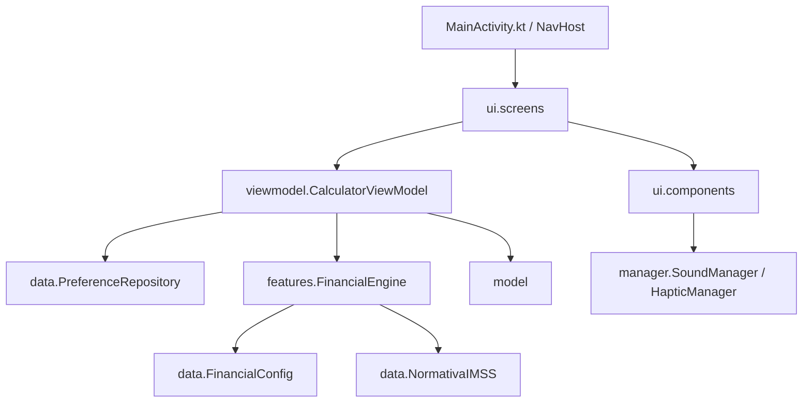

# ConsuCalcu Pro - AI Agent Blueprint & Roadmap

Este documento sirve como un **croquis de navegación, arquitectura y reglas de diseño** para cualquier agente de Inteligencia Artificial que trabaje en esta base de código en el futuro. Explica la estructura modular, el flujo de datos reactivo y las recetas paso a paso para extender la aplicación.

---

## 1. Mapa de Arquitectura (Estructura de Paquetes)

El código original monolítico de `MainActivity.kt` ha sido fragmentado bajo un patrón **MVVM modular y limpio**. A continuación se detalla la responsabilidad de cada paquete:



### Detalle de Paquetes:
*   [com.example.consucalcu.model](file:///Users/madd/AndroidStudioProjects/consucalcu/app/src/main/java/com/example/consucalcu/model/): Contiene solo estructuras de datos inmutables y puras (`Debt`, `LoanOffer`, `ClientData`, `UserProfile`). No contiene lógica de Android.
*   [com.example.consucalcu.data](file:///Users/madd/AndroidStudioProjects/consucalcu/app/src/main/java/com/example/consucalcu/data/): Contiene las configuraciones estáticas de negocio (`FinancialConfig`), las reglas del IMSS (`NormativaIMSS`) y la persistencia local (`PreferenceRepository`).
*   [com.example.consucalcu.features](file:///Users/madd/AndroidStudioProjects/consucalcu/app/src/main/java/com/example/consucalcu/features/): Aloja el núcleo de cálculo matemático (`FinancialEngine`) y el generador de tickets en formato de imagen (`TicketGenerator`).
*   [com.example.consucalcu.manager](file:///Users/madd/AndroidStudioProjects/consucalcu/app/src/main/java/com/example/consucalcu/manager/): Abstracciones de hardware y multimedia del sistema operativo (`SoundManager` para audio, `HapticManager` para vibración).
*   [com.example.consucalcu.utils](file:///Users/madd/AndroidStudioProjects/consucalcu/app/src/main/java/com/example/consucalcu/utils/): Métodos matemáticos utilitarios, extensiones de tipo `BigDecimal`, validación Luhn y generación de tablas de amortización.
*   [com.example.consucalcu.ui.components](file:///Users/madd/AndroidStudioProjects/consucalcu/app/src/main/java/com/example/consucalcu/ui/components/): Componentes composables reutilizables (entradas personalizadas "JuicyInput", gráficos de barras, diálogos modales de configuración e histórico).
*   [com.example.consucalcu.ui.screens](file:///Users/madd/AndroidStudioProjects/consucalcu/app/src/main/java/com/example/consucalcu/ui/screens/): Pantallas completas de la aplicación (`RefinanceScreen`, `NewCreditScreen`, `InsuranceScreen`, `MandatoryConfigScreen`).

---

## 2. Flujo de Reactividad y Efectos Secundarios

El ViewModel (`CalculatorViewModel`) no tiene referencias directas a elementos visuales de Android, contextos o administradores multimedia. En su lugar, se comunica de dos maneras:

1.  **State Flow (`uiState`):** Emite el estado de la UI de forma reactiva a las pantallas.
2.  **Side-Effects Channel (`effect`):** Un canal asíncrono que emite eventos de un solo disparo (`CalculatorEffect`) consumidos en la UI mediante `LaunchedEffect` en [MainActivity.kt](file:///Users/madd/AndroidStudioProjects/consucalcu/app/src/main/java/com/example/consucalcu/MainActivity.kt).

### Efectos Secundarios Disponibles:
*   `CalculatorEffect.PlaySound(soundName)`: Pide a la UI reproducir un efecto de audio precargado (e.g. `"cash"`, `"level_up"`, `"click"`).
*   `CalculatorEffect.TriggerHaptics(pattern)`: Pide a la UI ejecutar una textura táctil háptica (e.g. `HapticPatterns.SUCCESS`, `HapticPatterns.ERROR`, `HapticPatterns.KEYPRESS`).
*   `CalculatorEffect.GenerateTicket(...)`: Solicita a la vista generar y compartir el Ticket Dorado del cliente.

---

## 3. Recetas de Extensión (How-To)

### A. Cómo Agregar un Nuevo Producto Financiero
Para añadir una nueva financiera o producto (e.g. "BANCO AZUL"):
1.  Abre [FinancialConfig.kt](file:///Users/madd/AndroidStudioProjects/consucalcu/app/src/main/java/com/example/consucalcu/data/FinancialConfig.kt).
2.  Agrega una nueva entrada al mapa `PRODUCTS`:
    ```kotlin
    "BANCO AZUL TRADICIONAL" to ProductData(
        factorsTrad = mapOf(
            60 to BigDecimal("32.50000"), // Plazo to Factor
            48 to BigDecimal("35.20000")
        ),
        retention = RetentionRule(
            factors = mapOf(60 to BigDecimal("29.90000")),
            minAmount = BigDecimal("80000.0")
        ),
        meta = ProductMeta(tasaRef = 2.45, catTrad = "35.2%", catRet = "30.1%"),
        minGlobal = BigDecimal("30000"),
        minInc = BigDecimal("1000"),
        minTermMap = mapOf(60 to BigDecimal("30000"), 48 to BigDecimal("50000"))
    )
    ```
3.  Abre [FinancialEngine.kt](file:///Users/madd/AndroidStudioProjects/consucalcu/app/src/main/java/com/example/consucalcu/features/FinancialEngine.kt) y actualiza `MIN_RET_NUEVO` y `MIN_RET_CNCA` si el nuevo producto soporta tasas de retención:
    ```kotlin
    "BANCO AZUL" to BigDecimal("150000") // Límite para aplicar tasa de retención
    ```
4.  Abre `DropdownCompact` en [RefinanceScreen.kt](file:///Users/madd/AndroidStudioProjects/consucalcu/app/src/main/java/com/example/consucalcu/ui/screens/RefinanceScreen.kt) y asigna un color institucional a la marca en la función `getBrandColor(name)` si aplica.

### B. Cómo Modificar las Reglas de Viabilidad de un Seguro
1.  Abre [NormativaIMSS.kt](file:///Users/madd/AndroidStudioProjects/consucalcu/app/src/main/java/com/example/consucalcu/data/NormativaIMSS.kt).
2.  Modifica la lógica de negocio dentro de `evaluateViability` (e.g. ajustando límites de edad, exclusión de tipos de pensión o topes máximos de costo).
3.  Las pantallas y el ViewModel consumirán la nueva evaluación de viabilidad automáticamente.

---

## 4. Guía de Diseño Visual "Juicy Design System"

ConsuCalcu Pro utiliza un sistema de diseño premium, monocromático con detalles dorados y animaciones fluidas. Al crear nuevos elementos visuales, sigue estas reglas:

*   **Paleta de Colores (Identidad ConsuCalc):** Usa los tokens definidos en [Color.kt](file:///Users/madd/AndroidStudioProjects/consucalcu/app/src/main/java/com/example/consucalcu/ui/theme/Color.kt):
    *   Azul Marino Principal (Primario): `ConsuNavy` (`Color(0xFF0B1F44)`)
    *   Naranja de Acento: `ConsuOrange` (`Color(0xFFF95B00)`)
    *   Fondo Modo Claro: `ConsuBgLight` (`Color(0xFFF5F7FB)`)
    *   Fondo de Chips y Secundarios: `ConsuChipBg` (`Color(0xFFF0F3F8)`)
    *   Fondo Oscuro: `BgDark` (`Color(0xFF0A0F1D)`) | Superficie Oscura: `SurfaceDark` (`Color(0xFF101B3A)`)
    *   Bordes: `BorderLight` y `BorderDark`
    *   *Nota:* Para mantener la consistencia en todas las pantallas preexistentes, las variables históricas (`JuicyBlue`, `JuicyOrange`, `GoldAccent`, etc.) se remapearon a esta paleta institucional.
*   **Micro-animaciones:**
    *   Todos los botones clickeables deben usar el modificador `.bouncyClick()` (definido en `JuicyComponents.kt`) para dar respuesta táctil y visual al presionar.
    *   Usa `AnimatedResultItem` para renderizar listas con un efecto staggered de cascada.
*   **Audio y Háptica:**
    *   Cada interacción importante (guardar, cotizar, borrar) debe ir acompañada de un efecto de sonido emitido por el ViewModel y ejecutado a través del `soundManager`.
    *   Utiliza `triggerHapticTexture` o el modificador bouncy para dar feedback háptico sutil al usuario en pulsaciones largas y sliders.
